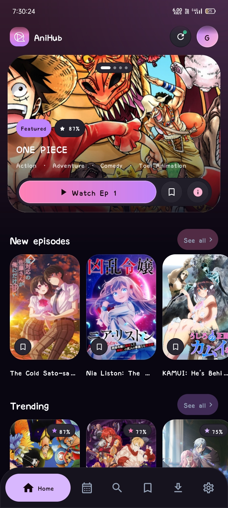
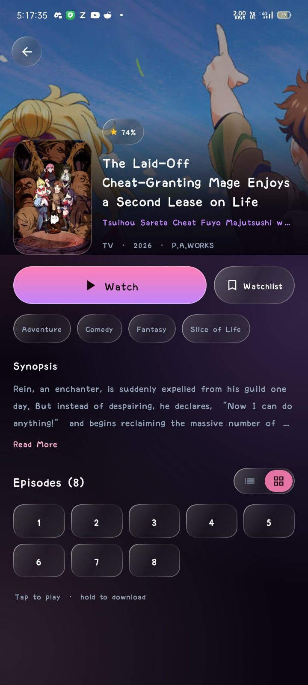

<div align="center">
  
  <h1>AniHub</h1>
  <br />
  <h3>Watch. Track. Make it yours.</h3>

  [](https://github.com/Godzilla679/AniHub/releases)
  [](https://github.com/Godzilla679/AniHub/releases/latest)
  [](https://discord.gg/Cvs4Svcqs7)
  

  <p>
    <b>AniHub</b> is a modern Android anime app with a glassy, fully themeable interface.
    Catch every new episode, stream in your favourite quality, keep your list in sync with AniList and MyAnimeList,
    download episodes for offline viewing, and change the whole look of the app to match your taste.
  </p>
</div>

---

## ✨ Features

### 🏠 **Home**
*   **Featured Carousel**: Big swipeable banners with one-tap *Watch* and *Details*.
*   **Continue Watching**: Jump straight back to the episode you stopped at.
*   **New Episodes**: The complete *Latest Episode* feed from AniKoto, page after page, with real episode numbers.
*   **Trending & Top Rated**: Poster rails powered by AniList and MyAnimeList.

### 🔍 **Search, Schedule & Details**
*   **Smart Search + Sort & Filter**: Find any series or movie fast.
*   **Airing Schedule**: See what airs each day of the week.
*   **Rich Detail Page**: Synopsis, genres, studio, score, and the full episode list (list or grid view).
*   **Sub / Dub Switch**: Pick your audio per episode.

### ▶️ **Player* 
*   **Quality Selector**: Auto or pick the resolution you want.
*   **Subtitles**: Choose language, size, colours, bold / italic, shadow, background and position.
*   **Playback Speed** and **Auto-Next** to keep binge sessions going.
*   **Watch Progress**: Episodes you've seen are remembered and shown in Continue Watching.

### 📥 **Offline**
*   **Download Episodes**: Save episodes (HLS) and watch without internet.
*   **Download Manager**: Choose where files are stored, resume downloads, clear the stream cache.

### 📚 **My List**
*   **Bookmarks**: Save anything to your list with one tap.
*   **AniList / MyAnimeList Sync**: Import, export and sync your lists.
*   **Google Sign-in**: Keep your profile and list tied to your account.

### 🎨 **Make It Yours**
*   **Two Complete Looks**: **Liquid Glass** (frosted, floating, glowing) or **Material** (solid, colourful tonal cards with an expanding navigation bar).
*   **10 Built-in Colour Themes**: Sakura, Cyber Rose, Peach Sunset, Cotton Candy, Emerald Forest, Ocean Deep, Crimson Ember, Golden Hour, Mocha & Cream, Lime Volt.
*   **Custom Themes**: Import a `.json` colour pack with **any number of colours** – they're spread across buttons, chips, headers and cards. Text switches between black and white automatically, so every background stays readable (even white).
*   **Fine-tuning**: Corner roundness, glass / surface strength, text size, background style (Glow / Flat / AMOLED black), multi-colour accents on/off.
*   **App or Device Font**: Use AniHub's own font or your phone's.

### 🔄 **Stay Updated**
*   **Built-in Auto-Updater**: New versions are fetched from GitHub Releases and installed in the app.

---

## 🖌️ Custom Theme Format

Only `colors` is required (any number, `#RGB`, `#RRGGBB` or `#AARRGGBB`).

```json
{
  "name": "Neon Nights",
  "colors": ["#FF4D94", "#7C4DFF", "#00E5FF", "#FFD54F", "#69F0AE"],
  "background": "#0B0614",
  "mode": "auto"
}
```

| Key | Required | What it does |
| --- | :---: | --- |
| `name` | – | Shown in Settings |
| `colors` | ✅ | The accent colours (any count) |
| `background` | – | Background colour; if missing it's picked from your colours |
| `text` | – | Text colour; used only if it's readable, otherwise black / white is chosen for you |
| `mode` | – | `auto`, `dark` or `light` |

Import it in **Settings → UI & Theme → Custom Themes → Import theme file**.

---

## 📱 Screenshots

<div align="center">
  <!-- Add your screenshots here -->
  
  
</div>

---

## 📥 Download

<div align="center">
  The latest signed APK is always on the Releases page.
  <br><br>
  <a href="https://github.com/Godzilla679/AniHub/releases/latest">
    
  </a>
</div>

**Requires Android 7.0 (API 24) or newer.** After the first install, AniHub updates itself.

---


---

## 💬 Community & Support

Need help, found a bug, or have an idea? Join the Discord.

<div align="center">
  <a href="https://discord.gg/Cvs4Svcqs7">
    
  </a>
</div>

---

> [!IMPORTANT]
> **Legal Disclaimer / DMCA:** AniHub does not host, store, upload, or distribute any media files on its servers. This project functions solely as a client interface that indexes and provides access to content from publicly available third-party sources.
> AniHub does not own or control any third-party content, and availability may vary depending on external providers.
> For copyright or legal concerns regarding specific media, please contact the respective hosting providers or rights holders directly.

&copy; 2026 **AniHub**. All Rights Reserved.
